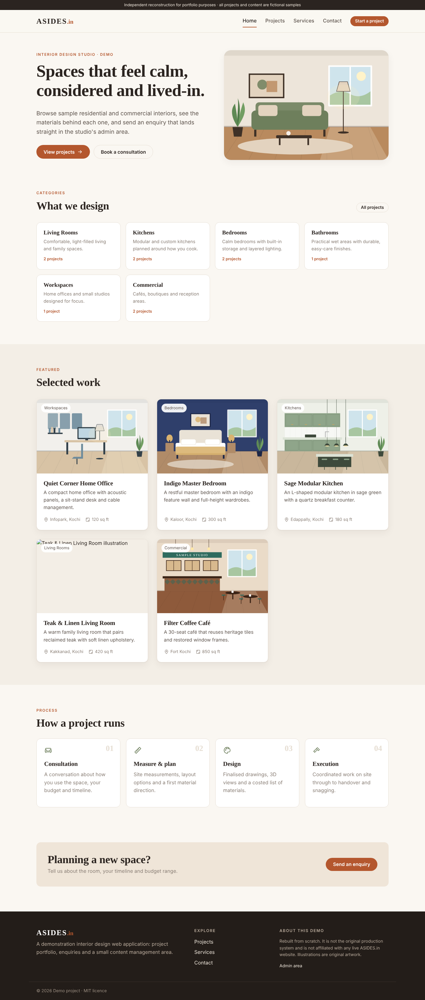
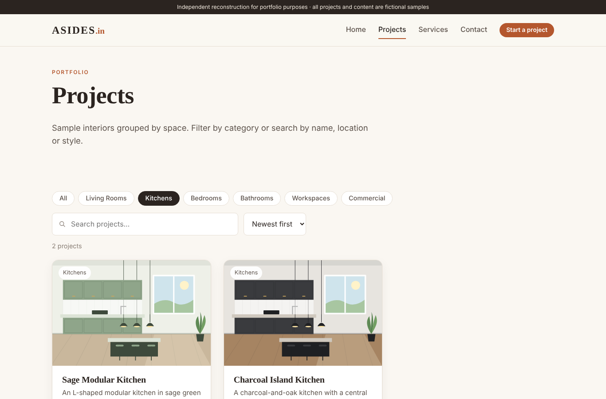
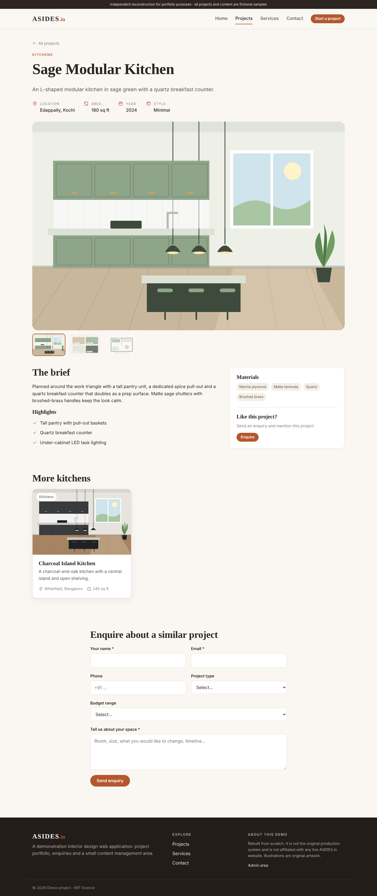
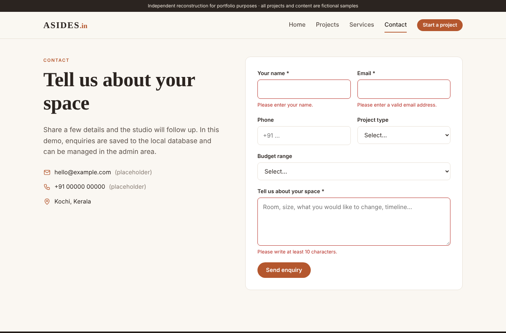
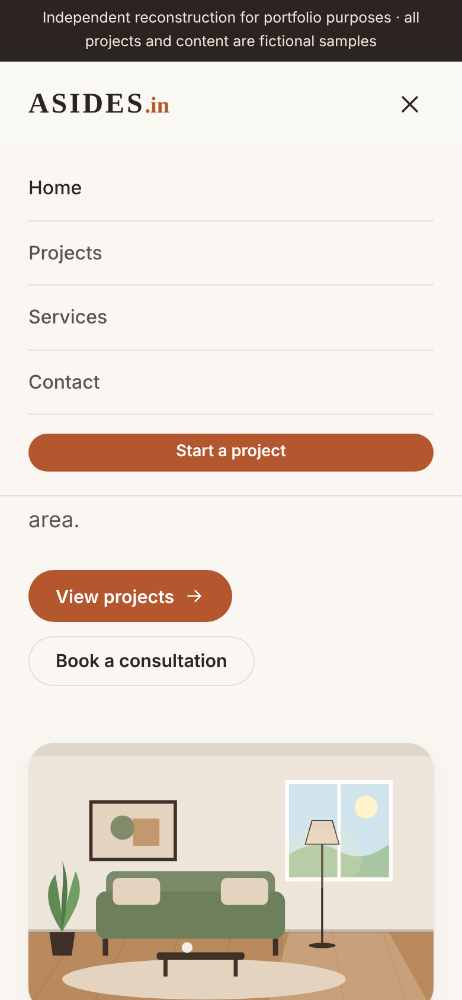
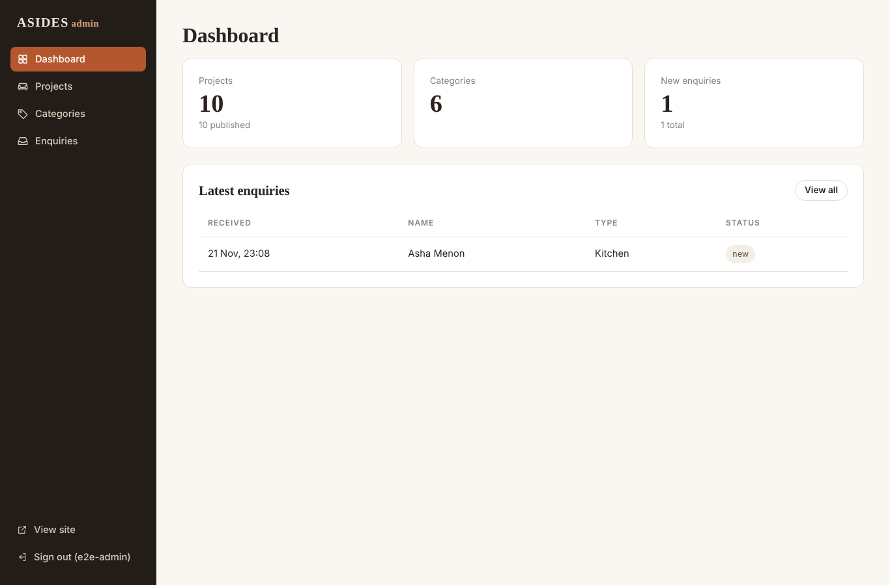
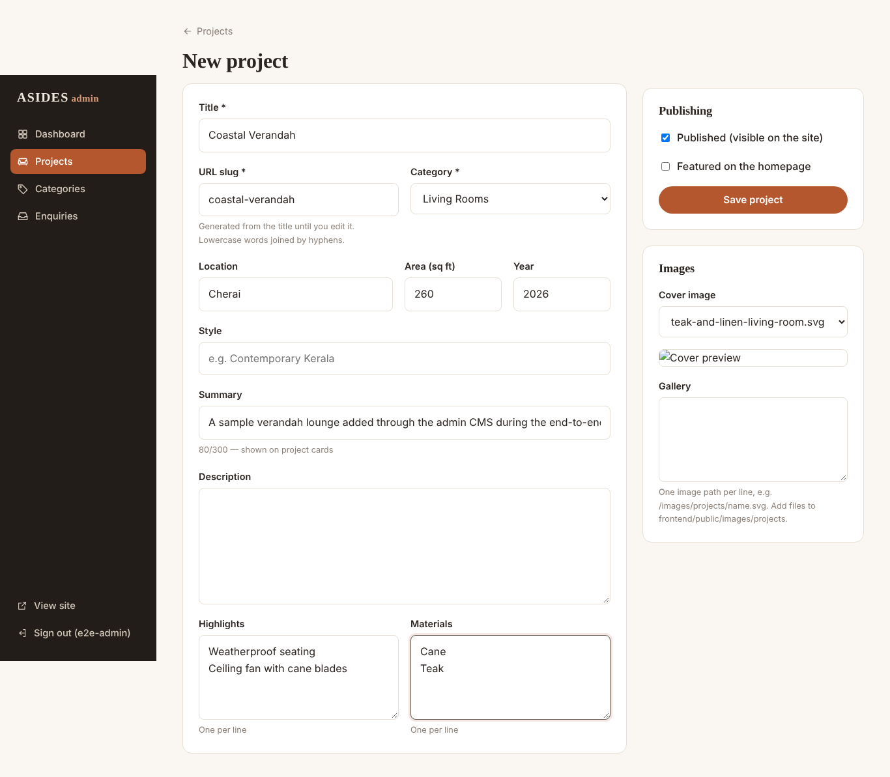
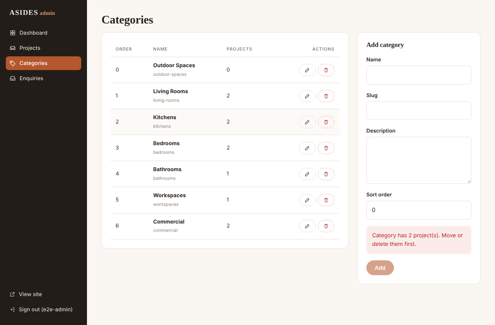
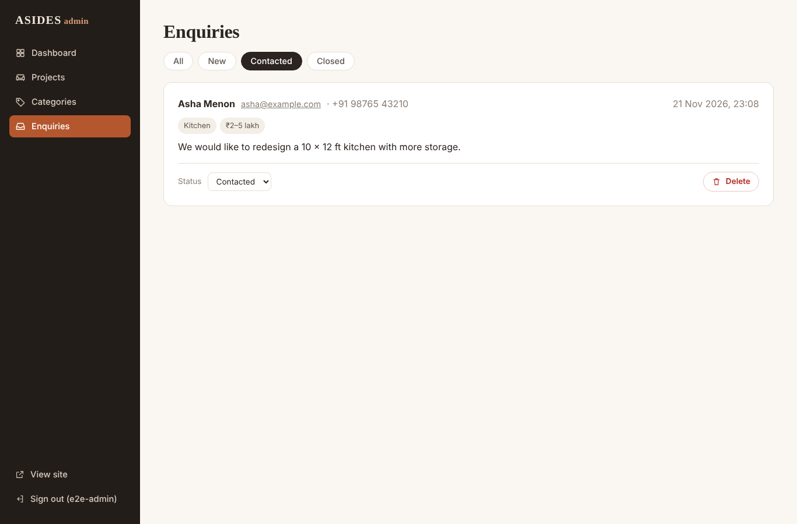

# ASIDES.in – Interior Design Web Application (Independent Reconstruction)

A full-stack, single-page interior design web application: a public portfolio site with project listings, project details and an enquiry form, plus a password-protected admin area for managing content.

> **About this repository**
> I originally worked on ASIDES.in as a client project at Elif Consultancy & Services. I no longer have access to the original source code, assets or data, so I **rebuilt this application from scratch** to show the same kind of work.
> - This is **not** the original production system, and it is not affiliated with any live ASIDES.in website.
> - **All projects, locations, descriptions and contact details are fictional sample content.**
> - **All images are original SVG illustrations** generated by [`tools/generate-artwork.mjs`](tools/generate-artwork.mjs) (MIT licensed). No stock photos or third-party images are used.



## Objectives

- Build a responsive single-page application with reusable components and client-side routing.
- Show interior design categories, a filterable and searchable project portfolio, and a detailed project page.
- Capture enquiries through a validated form and store them in a database.
- Provide an admin content management area to create, edit, publish/unpublish and delete projects, manage categories, and work through enquiries.
- Keep it simple to run locally, with automated tests at the API, component and browser level.

## Features

**Public site**
- Home page: hero, category overview with live project counts, featured projects, process steps.
- Projects page: category filter chips, debounced text search (title, summary, location, style) and sorting. Filters live in the URL, so filtered views can be bookmarked and shared.
- Project detail page: key facts, image gallery with thumbnails, highlights, materials, related projects in the same category, and an enquiry form linked to the project.
- Services and Contact pages; the contact form can be preselected from a service (`/contact?type=Kitchen`).
- Responsive layout with a mobile menu, skip link, keyboard focus styles, labelled form fields and reduced-motion support.

**Admin CMS** (`/admin`)
- Sign-in with credentials set in environment variables; HMAC-signed session tokens that expire after 8 hours.
- Dashboard with counts and the latest enquiries.
- Projects: list, create, edit, publish/unpublish, feature, delete. Slugs are generated from the title until you edit them, and duplicate slugs are rejected.
- Categories: add, edit and reorder; a category that still has projects cannot be deleted.
- Enquiries: filter by status (new / contacted / closed), update status, delete.

**API safeguards**: server-side validation for every write, parameterised SQL, JSON body size limit, a per-IP rate limit and honeypot field on the public form, and basic security headers.

## Technology stack

| Layer | Technology |
|---|---|
| Frontend | Angular 22 (standalone components, signals, zoneless change detection, reactive forms, lazy-loaded routes), TypeScript, SCSS |
| Backend | Node.js 22, Express 5 |
| Database | SQLite through Node's built-in `node:sqlite` module (no native build step) |
| Testing | `node:test` (API), Vitest via `ng test` (components and services), Playwright (`playwright-core`) for end-to-end browser checks |

The original application was frontend-focused Angular work, so the reconstruction keeps Angular for the UI and adds a small, readable backend to make the enquiry form and CMS actually work.

## Folder structure

```
asides-interior-design-web-application/
├── backend/
│   ├── src/
│   │   ├── app.js           # Express app: public + admin REST routes
│   │   ├── auth.js          # Admin credential check and signed tokens
│   │   ├── db.js            # SQLite schema and row mapping
│   │   ├── seed-data.js     # Fictional sample categories and projects
│   │   ├── seed.js          # Seeds an empty database (npm run seed resets it)
│   │   ├── server.js        # Entry point; also serves the built Angular app
│   │   └── validation.js    # Input validation for enquiries, projects, categories
│   ├── test/api.test.js     # 17 API tests against an in-memory database
│   └── .env.example         # Copy to .env and set your own admin password
├── frontend/
│   ├── src/app/
│   │   ├── core/            # Models, API service, auth service, interceptor and guard
│   │   ├── shared/          # Layout, icons, project card, enquiry form
│   │   ├── pages/           # Home, projects, project detail, services, contact, 404
│   │   ├── admin/           # Login, layout, dashboard, projects, project form, categories, enquiries
│   │   └── app.spec.ts      # Unit tests
│   ├── public/images/       # Generated SVG illustrations
│   └── proxy.conf.json      # Dev server proxies /api to the backend
├── e2e/smoke.mjs            # Browser test of public and admin flows; writes screenshots
├── tools/generate-artwork.mjs
├── docs/screenshots/
└── package.json             # Convenience scripts for the whole project
```

## Installation

Requirements: **Node.js 22.13 or newer** (for the built-in `node:sqlite` module) and npm.

```bash
git clone https://github.com/<your-username>/asides-interior-design-web-application.git
cd asides-interior-design-web-application
npm run install:all

# Configure the admin login
cp backend/.env.example backend/.env
# then edit backend/.env: set ADMIN_PASSWORD and ADMIN_TOKEN_SECRET to your own values
```

On first start, the backend creates `backend/data/asides.db` and loads the sample content. Run `npm run seed` at any time to reset the database to the sample content.

## Running the application

**Production-style (one server):**

```bash
npm run build     # builds the Angular app into frontend/dist
npm start         # http://localhost:3000 serves both the site and the API
```

**Development (live reload):** run the two commands in separate terminals:

```bash
npm run dev:api   # API on http://localhost:3000
npm run dev:web   # Angular dev server on http://localhost:4200 (proxies /api to :3000)
```

Admin area: open `/admin` and sign in with the username and password from `backend/.env`.

## Testing

```bash
npm test          # API tests (node:test) + frontend unit tests (Vitest)
npm run build && npm run e2e   # end-to-end browser checks; regenerates docs/screenshots
```

The end-to-end script starts the server on a temporary database with throwaway test credentials and needs a Chrome or Chromium binary. Set `CHROME_PATH` if it is not found automatically, or run `npx playwright install chromium` once.

Current results:

| Suite | Checks | Result |
|---|---|---|
| API (`backend/test`) | 17 | all passing |
| Frontend unit (`frontend/src/app/app.spec.ts`) | 7 | all passing |
| End-to-end browser (`e2e/smoke.mjs`) | 17 | all passing |

## REST API overview

| Method | Endpoint | Description |
|---|---|---|
| GET | `/api/categories` | Categories with published project counts |
| GET | `/api/projects?category=&q=&featured=&sort=` | Published projects with filters |
| GET | `/api/projects/:slug` | Project detail with related projects |
| GET | `/api/meta` | Allowed project types and budget ranges |
| POST | `/api/enquiries` | Submit an enquiry (validated, rate-limited) |
| POST | `/api/admin/login` | Returns a signed token |
| GET | `/api/admin/stats` | Dashboard counts |
| GET/POST/PUT/DELETE | `/api/admin/projects[/:id]` | Project CRUD, including drafts |
| POST/PUT/DELETE | `/api/admin/categories[/:id]` | Category management |
| GET/PATCH/DELETE | `/api/admin/enquiries[/:id]` | Enquiry inbox and status |

Admin routes require an `Authorization: Bearer <token>` header.

## Screenshots

| | |
|---|---|
|  Projects filtered by category |  Project detail |
|  Enquiry form validation |  Mobile navigation |
|  Admin dashboard |  Admin project editor |
|  Category management |  Enquiry inbox |

## Limitations

- **Sample content only.** Every project and detail is fictional; nothing represents real ASIDES.in clients or work.
- **No image upload.** The admin chooses from images in `frontend/public/images/projects` or types a path. Uploads with resizing and cloud storage would be the next step.
- **Single admin account** configured through environment variables; no user roles or password reset.
- **Enquiries are stored, not emailed.** No email or SMS notification is sent.
- **In-memory rate limiting** resets on restart and does not work across several server instances.
- `node:sqlite` is still marked experimental in Node 22. The npm scripts hide its warning; switching to `better-sqlite3` is a small change in `db.js` if needed.
- Not deployed; it is intended to be run locally.

## Licence

MIT, see [LICENSE](LICENSE). The SVG illustrations are original work and covered by the same licence.
